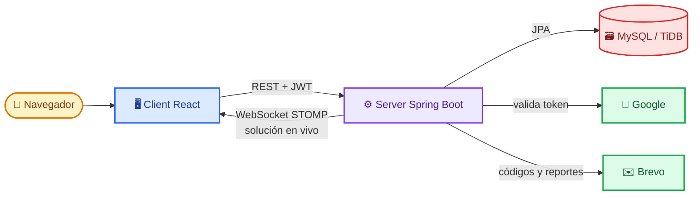
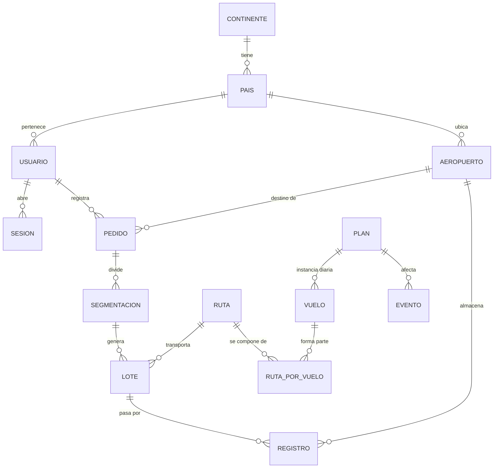

# 📦 MoraPack4D

**Planificador y visualizador logístico de tráfico aéreo.**

Sistema web que optimiza el traslado de productos a nivel global. Divide cada pedido en **lotes**, que pueden separarse o reagruparse en puntos intermedios, y los asigna a rutas de forma adaptativa según los plazos de entrega y las capacidades de vuelos y aeropuertos en cada momento.

---

## ✨ Qué hace

- 🧭 **Planificación de rutas:** calcula con una metaheurística GVNS la ruta de cada pedido, desde una sede hasta su destino, respetando plazos de entrega y capacidades.
- 🔁 **Replanificación automática o manual:** reorganiza los envíos afectados cuando un vuelo se cancela, se reprograma o cambia de capacidad.
- 🗺️ **Trackeo en vivo 2D:** muestra vuelos, sedes y pedidos en un mapa que se actualiza en tiempo real.
- 📥 **Importación de datos:** carga aeropuertos, planes de vuelo, pedidos y eventos desde archivos `.txt`.
- 📄 **Exportación de reportes:** genera reportes en PDF y TXT, y los puede enviar por correo.
- 🔐 **Autenticación:** sesión con **JWT**, registro por **correo** con código de verificación de 6 dígitos e inicio de sesión con **Google**.

---

## 🧪 Probar la aplicación

| 🔗 | Servicio | URL |
|---|---|---|
| 🖥️ | **Web** | https://cdx-morapack4d.onrender.com/ |
| ⚙️ | **API** | https://cdx-morapack4d-server.onrender.com/ (solo responde a la web) |

La primera carga puede tardar hasta un minuto.

### Usuarios de prueba

Todos usan la contraseña `12345678`.

| Rol | Correo |
|---|---|
| 🛡️ Administrador | `administrador@g4d.com` |
| 🛠️ Trabajador | `trabajador@g4d.com` |
| 🧳 Cliente | `cliente@g4d.com` |

### Probar la simulación

En el servidor están cargados los pedidos del archivo `PedidosCandy_vSM-hard.txt`, que está en `archive/pedidos/simulacion/`.

1. Inicia sesión como **trabajador**.
2. Entra a **Simulación** y configura la simulación semanal. Se recomienda:

| Campo | Valor |
|---|---|
| Fecha y hora de inicio | `02/12/2025` a las `00:00` |
| Multiplicador temporal | `180` |
| Resto de opciones | Las que vienen por defecto |

3. Ejecútala y mira cómo los vuelos se dibujan en el mapa.

---

## 🧰 Stack

| Capa | Tecnologías |
|---|---|
| ⚙️ **Back** (`server/`) | Java 21, Spring Boot 3.5, Spring Data JPA, Spring Security (JWT), WebSocket/STOMP, OpenPDF, Maven |
| 🎨 **Front** (`client/`) | React 18, Vite 7, React Router 7, Leaflet, three.js, Recharts, STOMP.js, SASS |
| 🗃️ **Base de datos** | MySQL (local) · TiDB Cloud (producción) |
| ✉️ **Correo** | Brevo (API HTTP) |
| ☁️ **Despliegue** | Render |

### 🏗️ Arquitectura



### 👥 Roles

| Rol | Qué puede hacer |
|---|---|
| 🧳 `CLIENTE` | Registra pedidos y sigue sus envíos. |
| 🛠️ `TRABAJADOR` | Opera la planificación: operación en vivo, simulación, pedidos y planes de vuelo. |
| 🛡️ `ADMINISTRADOR` | Gestiona usuarios, aeropuertos y sedes, países y los parámetros del algoritmo. |

### 🗄️ Modelo de datos

El DDL completo está en [`server/src/main/resources/db/seed/01_ddl.sql`](./server/src/main/resources/db/seed/01_ddl.sql).



| Grupo | Tablas | Para qué sirven |
|---|---|---|
| 🌎 Ubicación | `continente`, `pais`, `aeropuerto` | El aeropuerto con `es_sede = 1` es un origen; los demás son destinos. |
| 👤 Accesos | `usuario`, `sesion`, `verificacion_correo` | Cuentas por rol, sesiones por dispositivo y códigos de 6 dígitos. |
| 📦 Pedidos | `pedido`, `segmentacion`, `lote` | Un pedido se divide en lotes y cada lote viaja por una ruta. |
| ✈️ Vuelos | `plan`, `vuelo`, `ruta`, `ruta_por_vuelo` | El plan es la plantilla diaria, el vuelo su instancia y la ruta es la secuencia de vuelos. |
| 🏬 Almacenes | `registro` | Ingreso y egreso de lotes en cada aeropuerto. |
| ⚠️ Cambios | `evento` | Cancelación, reprogramación o reajuste de capacidad de un vuelo. |
| 🎛️ Configuración | `parametros` | Fila única con plazos y factores del algoritmo. |

---

## 📁 Estructura del repositorio

```
MoraPack4D/
├── client/
│   ├── public/
│   └── src/
│       ├── api/
│       ├── auth/
│       ├── components/
│       ├── pages/
│       ├── realtime/
│       └── scenario/
├── server/
│   └── src/main/
│       ├── java/com/pucp/dp1/grupo4d/morapack/
│       └── resources/db/seed/
└── archive/
    ├── aeropuertos/
    ├── pedidos/
    └── planes/
```

---

## 💻 Instalación local

### ✅ Requisitos

- Java 21
- Node 20 o superior
- MySQL en local (o una base de TiDB Cloud)

### 🪜 Pasos

**1. Levantar el back y cargar la base**

```bash
cd server
cp .env.example .env     # completa tus valores
./seed.sh                # Windows: .\seed.ps1  (borra y recrea la BD)
./mvnw spring-boot:run   # http://localhost:8080
```

**2. Levantar el front**

```bash
cd client
cp .env.example .env.local
npm install
npm run dev              # http://localhost:5173
```

**3. Cargar los datos de trabajo**

Entra como administrador e importa, desde la carpeta `archive/`, los **aeropuertos** (marca las sedes en *Aeropuertos y sedes*), los **planes de vuelo** y los **pedidos**.

---

## 🔐 Variables de entorno

### ⚙️ Server (`server/.env`)

| Variable | Descripción |
|---|---|
| `SPRING_PROFILES_ACTIVE` | `dev` = MySQL local, `tidb` = TiDB Cloud. |
| `SERVER_PORT` | Puerto del back (8080 por defecto). |
| `CORS_ORIGINS` | Dominios del front permitidos, separados por coma. |
| `LOCAL_DB_HOST`, `LOCAL_DB_PORT`, `LOCAL_DB_NAME`, `LOCAL_DB_USER`, `LOCAL_DB_PASSWORD` | Conexión a MySQL local. |
| `TIDB_DB_HOST`, `TIDB_DB_PORT`, `TIDB_DB_NAME`, `TIDB_DB_USER`, `TIDB_DB_PASSWORD` | Conexión a TiDB (el usuario lleva prefijo `xxxx.root`). |
| `BREVO_API_KEY`, `MAIL_REMITENTE`, `MAIL_REMITENTE_NOMBRE` | Envío de correos. Sin la key, el código se imprime en consola. |
| `GOOGLE_CLIENT_ID` | El mismo Client ID que usa el front. |
| `JWT_SECRET` | Clave para firmar los tokens. |

### 🖥️ Client (`client/.env.local`)

| Variable | Descripción |
|---|---|
| `VITE_GOOGLE_CLIENT_ID` | Client ID de Google. |
| `VITE_API_URL` | URL del back en producción. En local se deja vacía. |

Los archivos `.env` no se suben al repositorio.

---

## 📜 Scripts disponibles

| Comando | Dónde | Qué hace |
|---|---|---|
| `./mvnw spring-boot:run` | `server/` | Levanta la API. |
| `./seed.sh` o `.\seed.ps1` | `server/` | Borra las tablas, las recrea y carga países, usuarios de prueba y parámetros. |
| `npm run dev` | `client/` | Servidor de desarrollo de Vite. |
| `npm run build` | `client/` | Genera el build de producción. |
| `npm run preview` | `client/` | Sirve el build en local. |

---

## 📐 Reglas de diseño

| Regla | Detalle |
|---|---|
| Sedes y destinos | Las sedes (`es_sede`) son los únicos orígenes de la carga. |
| Tiempos en UTC | Todas las fechas y horas se guardan en UTC. |
| Plazos configurables | Días máximos de entrega, horas de recojo y de estancia viven en `parametros`. |
| Sesión | Token de acceso corto y sesión de hasta 12 horas por dispositivo. |
| Simulación aislada | Sus clientes y almacenes no se guardan en la BD. |
